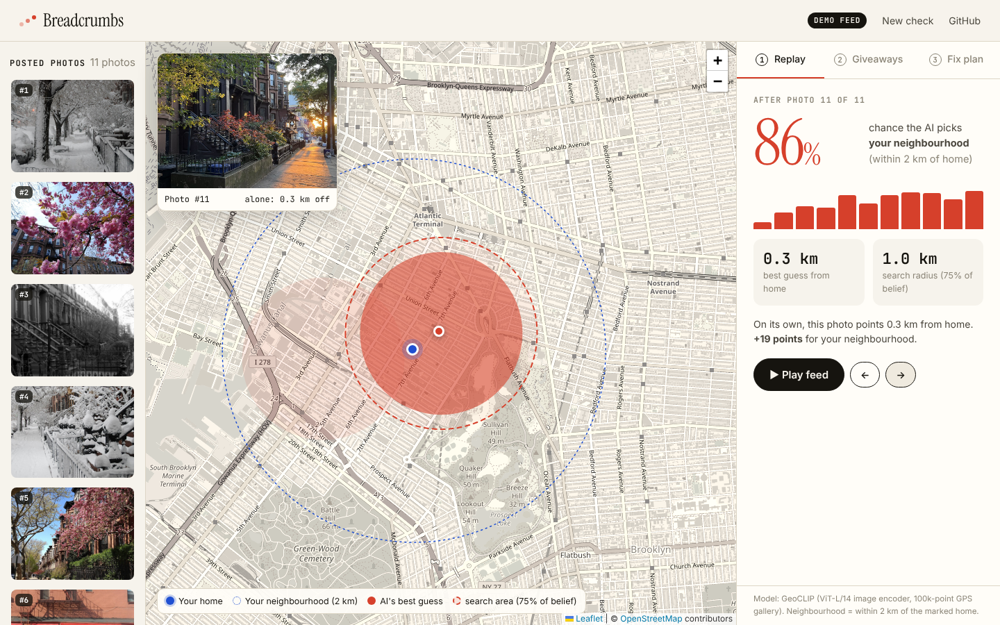
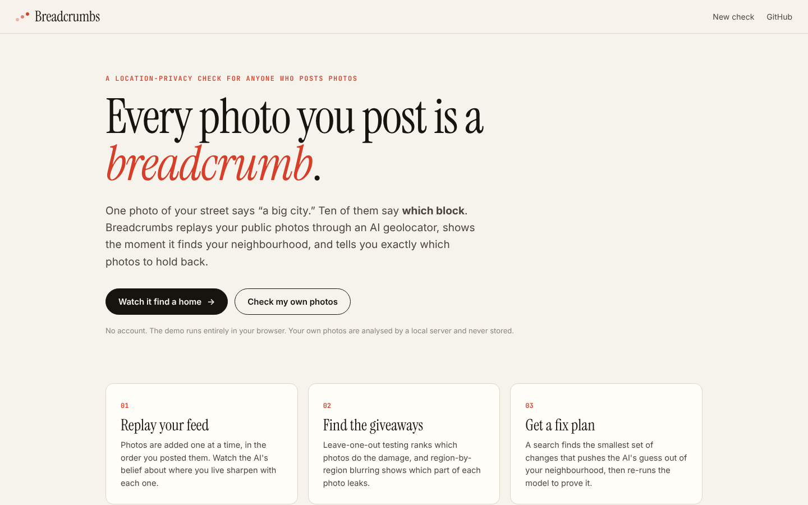
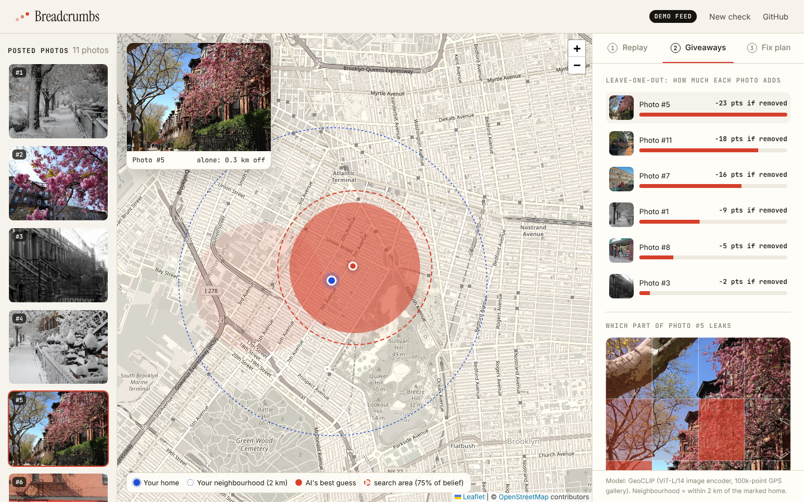
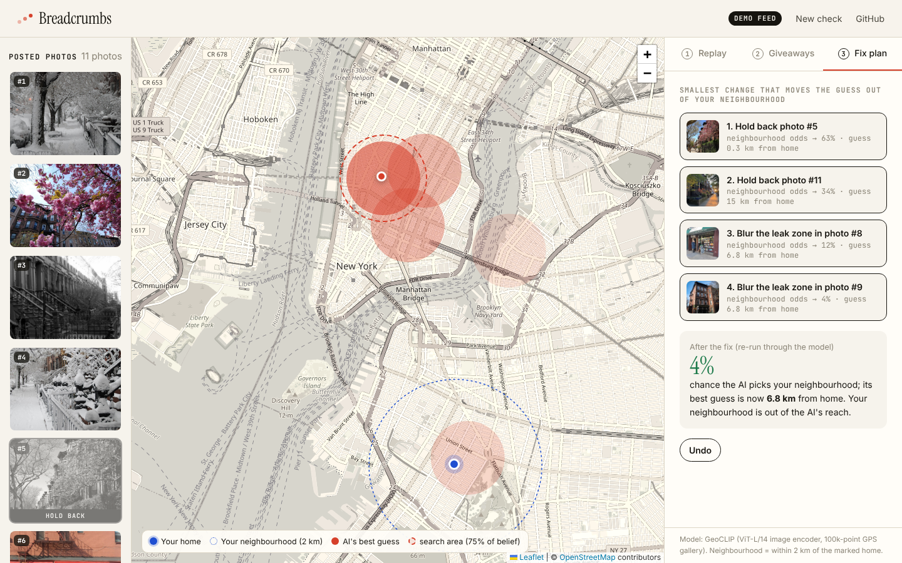
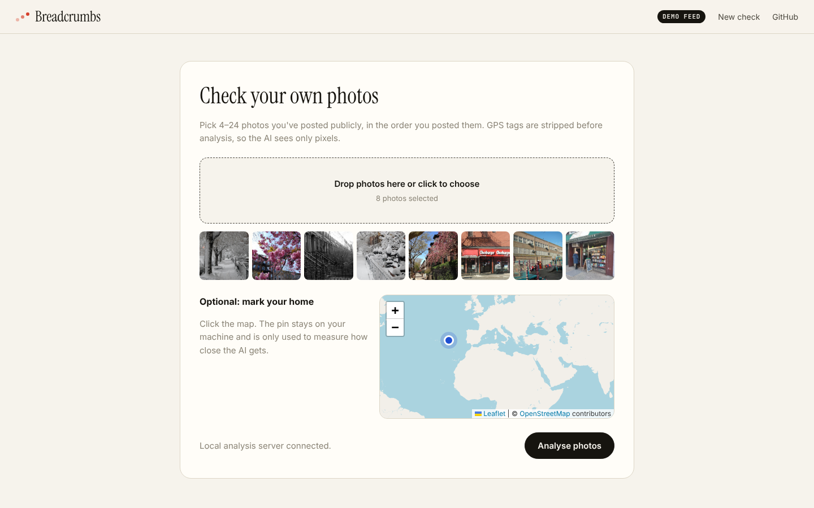

<div align="center">

# Breadcrumbs

**See how close an AI can get to your home — using only the photos you've already posted.**

Built for **[Build With AI: Basics](https://learn-ai-basics.devpost.com/)** (Devpost, October 2026), planned and built with the [Devpost Learn Skill Pack](https://github.com/challengepost/learn-ai-basics).



</div>

---

## The problem

Stripping GPS tags and blurring faces protects **one** photo. But nobody trying to find you looks at one photo — they look at your feed.

A snowy street says "a big city." Cherry blossoms on a brownstone say "probably the US Northeast." A bookstore, a playground, a sunset on a residential block — each is vague on its own. **Together they triangulate.** Open AI geolocation models now do this in seconds, and every privacy tool we found (EXIF strippers, face/plate blurrers, and recent research such as GeoShield, GeoCloak and GeoEdit) works one image at a time.

**Breadcrumbs measures the combined leak across your whole feed** and tells you the smallest change that breaks it.

**Who it's for:** anyone who posts photos publicly and doesn't want strangers to know where they live — people dealing with a stalker or an ex, creators with a following, parents, journalists.

## What it does

| | |
|---|---|
| **1. Replay** | Your photos are added one at a time, in the order you posted them. The map shows the AI's belief about where you live sharpening, and the panel shows the chance it picks **your neighbourhood** (within 2 km of a home you mark). |
| **2. Giveaways** | Leave-one-out testing ranks which photos do the damage. Blurring each of 16 regions of a photo shows **which part** of it leaks, and pairwise overlap shows which photos corroborate each other. |
| **3. Fix plan** | A greedy search finds the smallest set of edits — hold back a photo, or blur its leak zone — that moves the AI out of your neighbourhood, then **re-runs the model** to prove it. |

### On the bundled demo feed (real model output)

11 openly licensed photos taken around one block in Park Slope, Brooklyn, none showing an address:

- After photo 1, the AI gives the neighbourhood **15%**. After photo 11: **86%**, with its best guess **0.3 km** from the "home".
- The search radius holding 75% of its belief shrinks from **306 km to 1 km**.
- The fix plan holds back 2 photos and blurs the leak zones in 2 others. Re-run through the model: **4%**, and the best guess is now **6.8 km** away.

These numbers come from one model (GeoCLIP) on one feed; your results will differ.

## Screenshots

| Landing | Giveaways |
|---|---|
|  |  |
| **Fix plan, applied** | **Check your own photos** |
|  |  |

## How it works

```
photos ──► GeoCLIP image encoder ──► score vs 100k GPS points ──► bin into ~1.7 km cells
                                                                         │
           ┌─────────────────────────────────────────────────────────────┘
           ▼
   product of experts across photos  (÷ density prior at half strength, 2% "elsewhere" floor)
           │
           ├─► replay: belief after photo 1, 2, … n
           ├─► leave-one-out: how much each photo adds
           ├─► 4×4 region blurs: which part of each photo leaks
           └─► greedy fix plan → re-fuse → verify
```

- **Model.** [GeoCLIP](https://github.com/VicenteVivan/geo-clip) (Vivanco Cepeda et al., NeurIPS 2023) scores an image against any GPS coordinate, so every photo can be evaluated on one shared set of locations.
- **Cells, not points.** Photos of one neighbourhood aren't taken at one exact spot. Fusing individual GPS points locked onto an unrelated point 15 km away; fusing smoothed ~1.7 km cells lets nearby photos agree.
- **Prior correction.** Each photo's belief already contains "lots of photos are taken in big cities." Multiplying photos multiplies that bias, so it's divided back out. Full strength over-rewarded sparsely photographed cells; half strength was stable.
- **Measured, not asked.** Every explanation comes from re-running the model with something removed — not from asking an AI to explain itself, which recent work (GeoRC, ACL 2026) shows is unreliable for geolocation.
- **Defensive by design.** It only analyses photos you upload. No profile lookups, no scraping. GPS EXIF is stripped before analysis and photos are never written to disk.

## Run it

**Demo only (no backend):** serve the `web/` folder with any static server and click **Watch it find a home**.

```bash
cd web && python -m http.server 8000
```

**Full app (analyse your own photos locally):**

```bash
git clone https://github.com/Abdullah49645/breadcrumbs
cd breadcrumbs
python -m venv .venv && source .venv/bin/activate
pip install -r requirements.txt
uvicorn server.app:app --port 8000
# open http://localhost:8000 → Check my own photos
```

First run downloads the GeoCLIP weights (~1.6 GB). Analysis runs on CPU: about 100 s for 6 photos on a 2-core machine.

**Rebuild the demo session:**

```bash
python -m server.precompute demo/photos --home 40.6712,-73.9790 \
  --order p04.jpg,p06.jpg,p08.jpg,p05.jpg,p07.jpg,p10.jpg,p12.jpg,p09.jpg,p13.jpg,p15.jpg,p16.jpg
```

## Project structure

```
server/engine.py      fusion, explanations, fix plan
server/app.py         FastAPI server (upload, jobs, photo serving)
server/precompute.py  builds web/demo/session.json
web/                  static app: index.html, app.js, styles.css, demo/
demo/photos/          demo source photos + credits.json
devpost/              scope.md, prd.md, spec.md, checklist.md (Skill Pack planning docs)
```

## How it was built

The project was planned with the Devpost Learn Skill Pack before any code was written: `2-scope` → [`devpost/scope.md`](devpost/scope.md), `3-prd` → [`devpost/prd.md`](devpost/prd.md), `4-spec` → [`devpost/spec.md`](devpost/spec.md), and `5-build` sliced the work in [`devpost/checklist.md`](devpost/checklist.md). The checklist's **Revisions** section records where the build proved the plan wrong (point fusion → cell fusion, prior correction strength, the fix-plan objective).

## Limitations

- One open model. Commercial geolocators are stronger; whether the fix transfers to them is untested.
- Region blurs are coarse (4×4 grid); inpainting would hide clues more naturally.
- The greedy plan is not guaranteed minimal.
- A low score means *this model* couldn't find you, not that nobody can.

## Credits

- Demo photos: Wikimedia Commons contributors under CC0 / CC BY / CC BY-SA licences — full per-photo attribution in [`demo/photos/credits.json`](demo/photos/credits.json).
- Map tiles © OpenStreetMap contributors. Map library: Leaflet.
- Geolocation model: GeoCLIP (MIT licence).

## License

[MIT](LICENSE)
